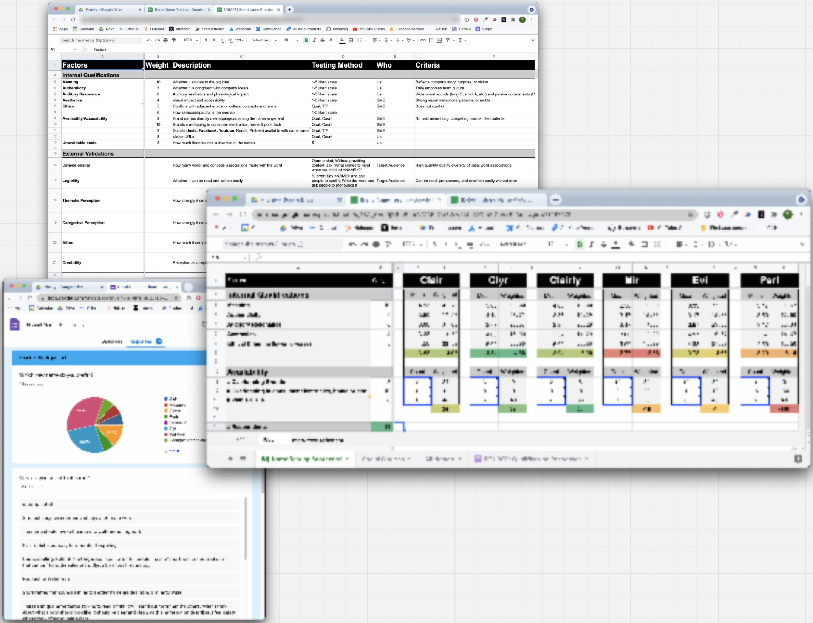
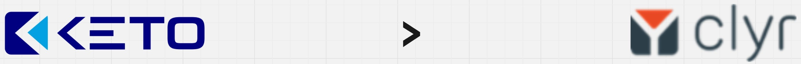
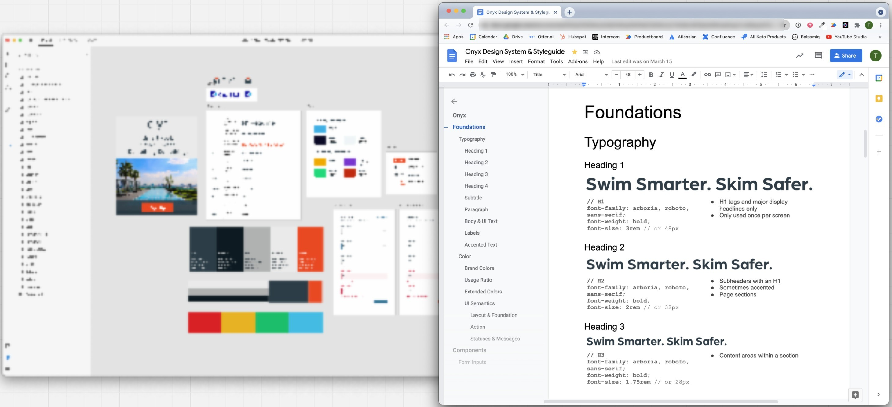
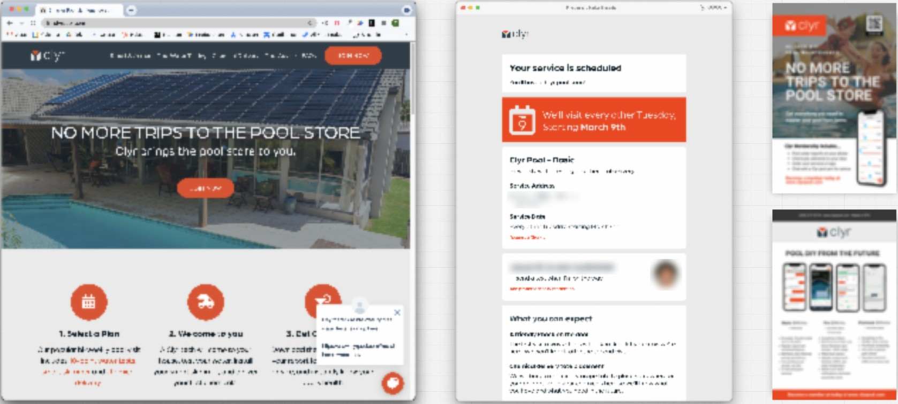
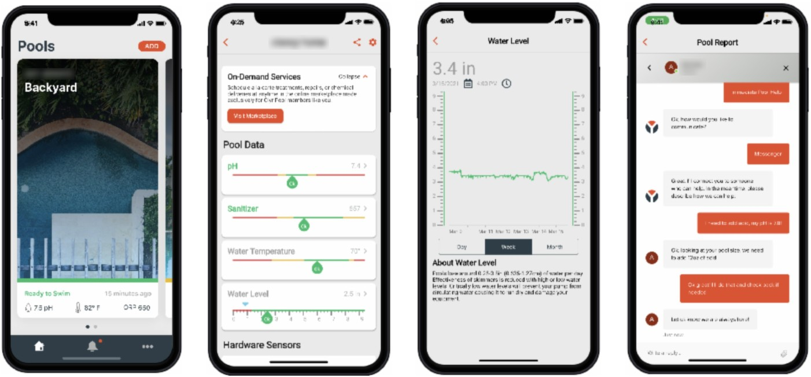
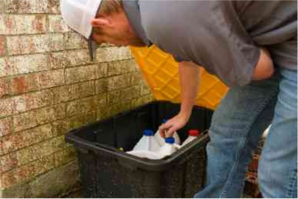

After acquiring and retaining 30+ recurring customers for a novel high-tech pool service at home, we discovered our name was getting in the way of organic traction. The word “Keto” worked against us instead of carrying the brand forward on its own.

We decided before we launch we needed a new name and a new visual identity system that separated us from the now crowded pool tech space.

## Renaming

Partnering with Primer Grey, we generated dozens of new name options, but had trouble achieving consensus.

To combat the stalemate, I developed a brand name rubric and testing framework to identify the most qualified names with real data and evidence.

## Logo design

We loved certain elements of the old logo, but it definitely had some problems beyond the name alone; the main problem was the wordmark.

I designed a symbol that allowed for various lockups while still incorporating existing brand equity like sharp angles against rounded edges.

Standalone “Clyr” wordmark/letterforms designed by Primer Grey.

## Design system

Recoloring the app ended up being fairly low effort since I had already begun on a primitive design system using XD; I formalized the spec for developers using a google sheet. The system is named “Onyx” as a nod to the color palette and one of the art deco/grotesk inspired typefaces chosen for the new identity.

## Communications design

## Solution

Along with recoloring the app, we added additional features to help users connect with service companies who were using the Keto Pool Service SaaS to manage customer relationships.

## In action

I rode along with our Clyr Crew to do field studies, capture the visual story of how Clyr Pool service works, and demonstrate why it is different than traditional pool services.

