After a 3D printed prototype of a “smart skimmer” IoT device survived in the founder's pool for a year, he decided to establish a team and share his invention with the world.

We set out to revolutionize DIY pool maintenance so tech-savvy pool owners can skim smarter and swim safer.

## Collecting inspiration

Before diving in to the explicit UX needs, I sought out creative fuel on Pinterest to develop an opinion about the visual style for the brand. The team then used affinity mapping to sort and filter styles into various boards and hone in on a style.

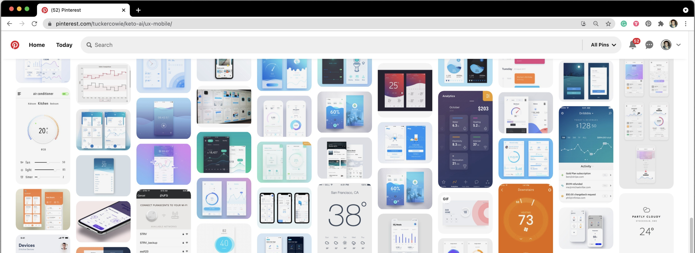

## Visionboard

Since there are thousands of design decisions made in a lean startup, before committing to any explicit designs, I designed this mood board to serve as a way to empower developers with creative direction so I wouldn't need to make every design decision myself.

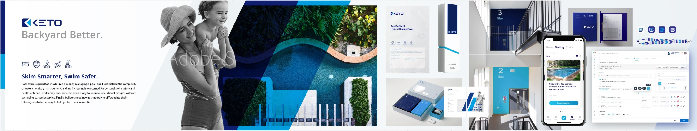

## User insights

Through interviews with pool owners, we discovered that major pool problems emerge (and most consumer spending occurs) when the chemistry swings too far beyond normal ranges.

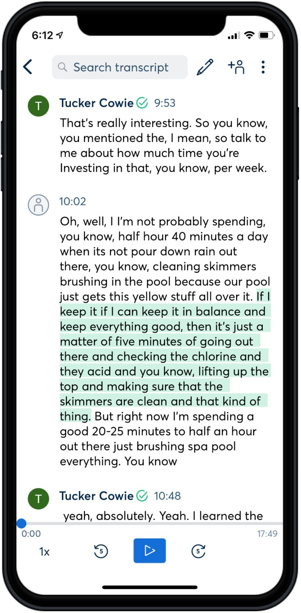

> “If I can keep [the pool's chemistry] in balance and keep everything good, then it's just a matter of five minutes...”

> [!INSIGHT]
> Pool Owners need to increase the frequency of dosing while decreasing time chemistry is out of balance in order to keep maintenance effort low.

## Facilitated ideation

I facilitated remote ideation sessions to source ideas and involve the founders + developers in the UX process and help expose technical issues early.

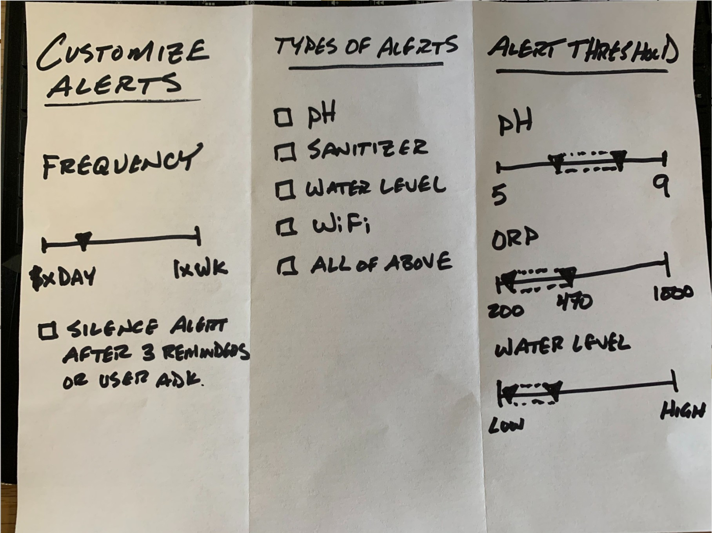

## Wireframing

I consolidated the best ideas into Balsamiq wireframes so the team could further critique and refine concepts remotely and evaluate architectural decisions early.

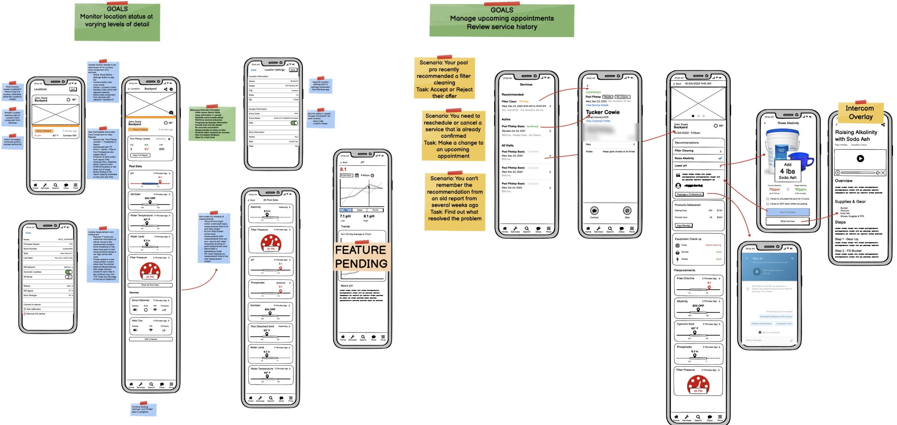

## User testing

Once we had working versions of the hardware integrated with the device setup process, we enlisted fellow pool owners to test our first versions on their own phones.

*We discovered unavoidable technical limitations created undue friction that could be alleviated in future versions, but cost too much for us to fix immediately. We incorporated other refinements to smooth over the experience.*

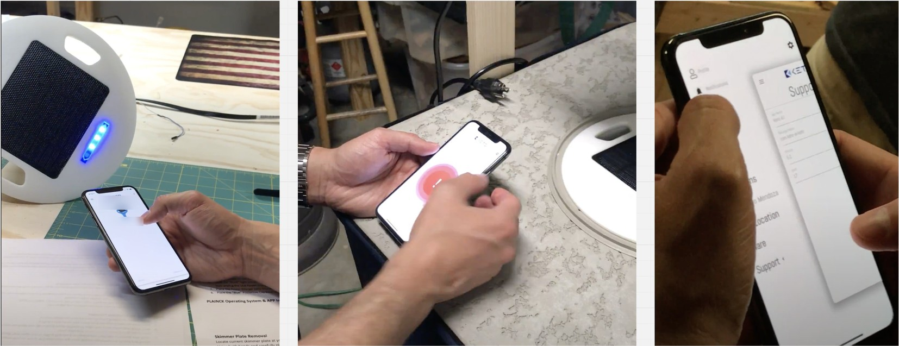

## Solution

The first major release walked users through hardware setup so they could effortlessly monitor their pool and get real time recommendations and alerts to keep their pool balanced.

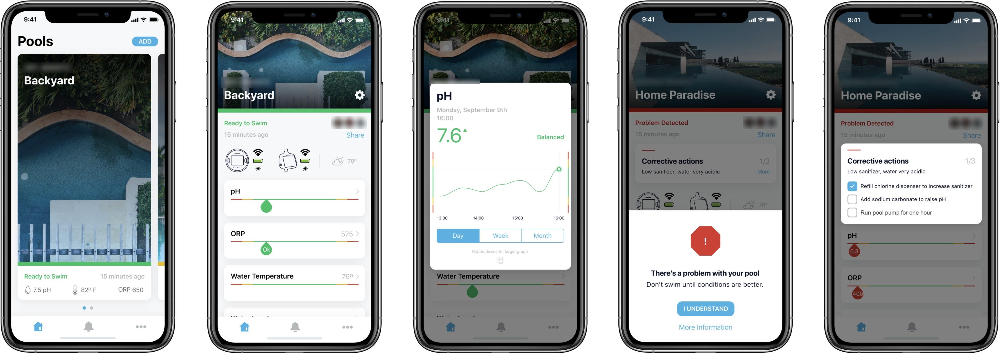

## In action

In spring of 2020, we started selling Smart Skimmers directly to pool owners. The team assembled and shipped them directly from the co-founder's garage workshop.

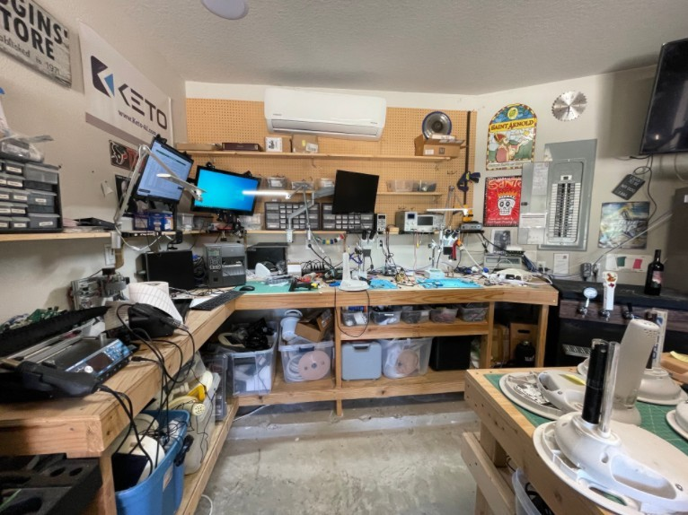

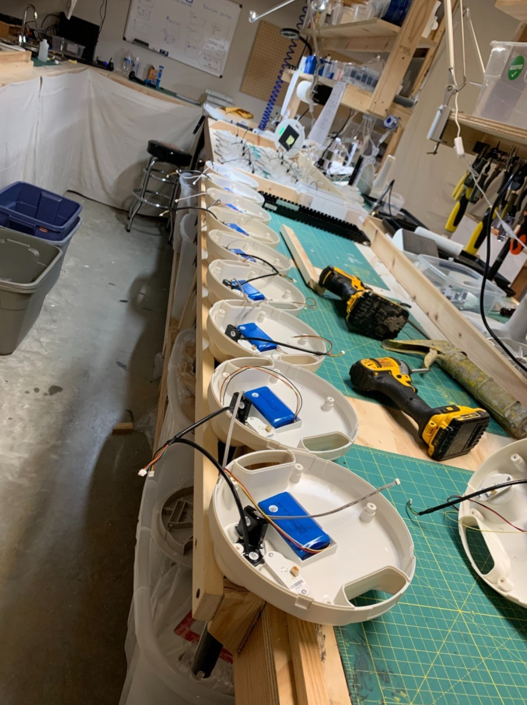

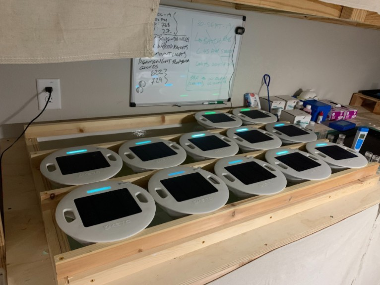

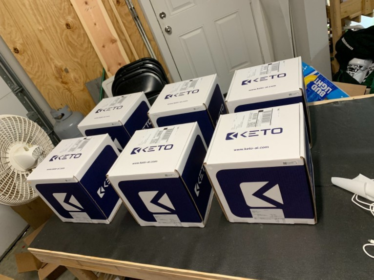
