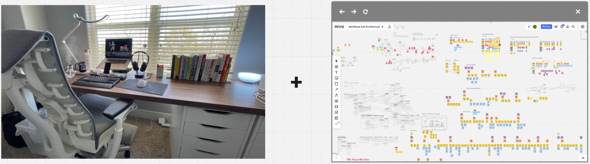
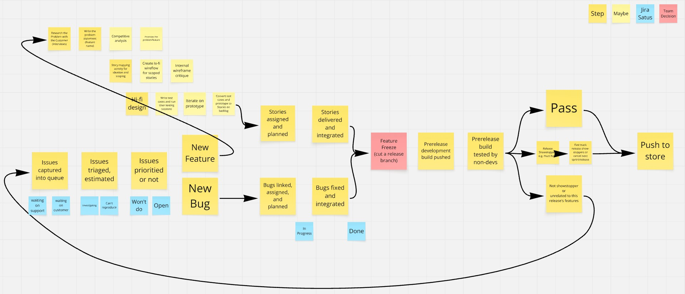
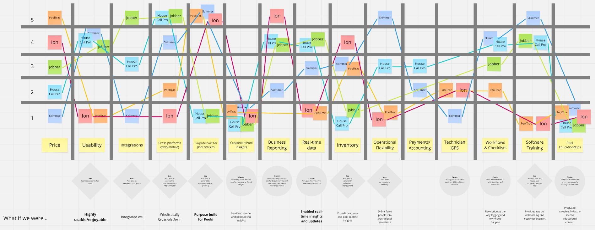
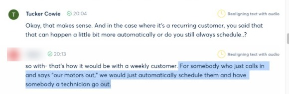
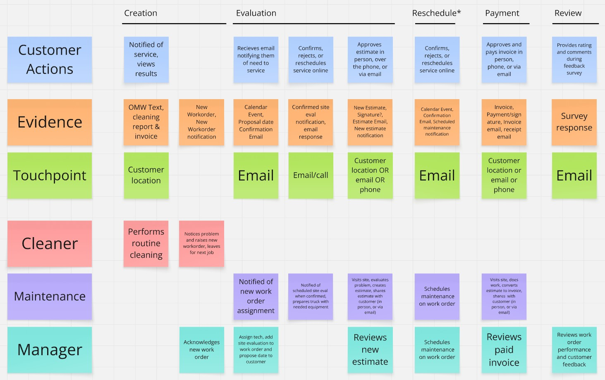
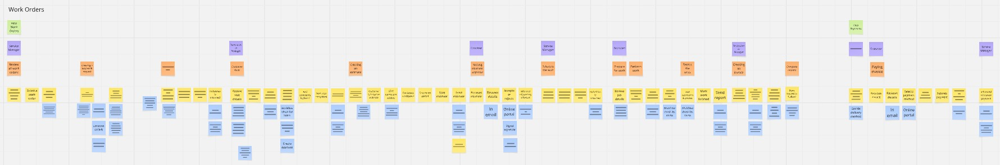
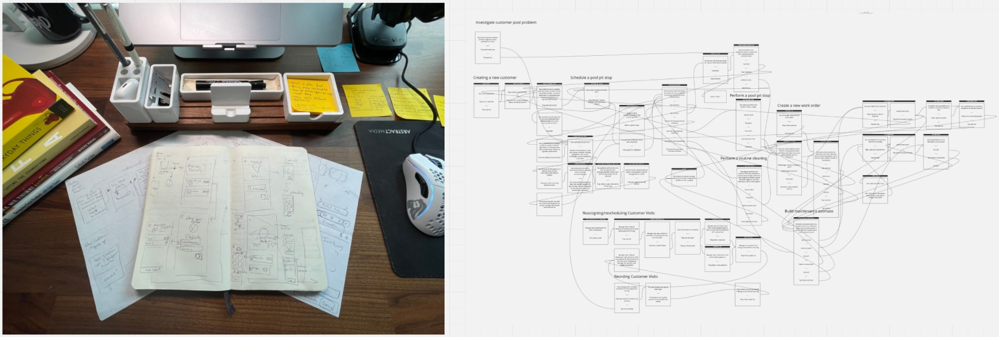
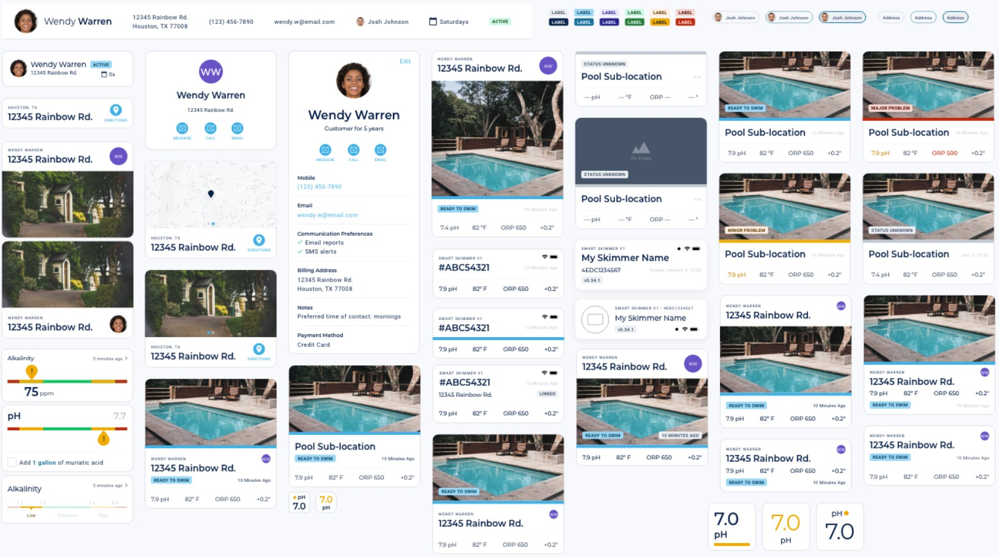
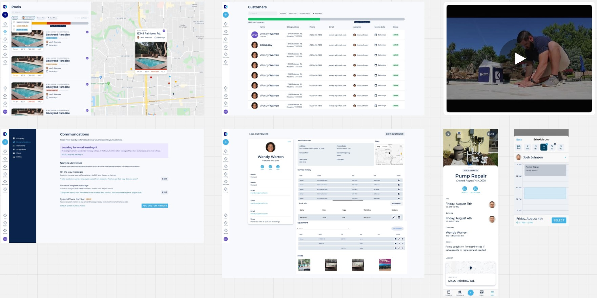

The $15B pool services industry is extremely fragmented. This means no company operates the same way and only a few operational standards have emerged. After successfully creating an at-home monitoring solution using the smart skimmer, we moved to test a separate product hypothesis regarding pool service companies: How might the smart skimmer disrupt the way pool *professionals* operate?

## Work environment

When working together was no longer an option, we established recurring virtual meetings and pivoted to accommodate lean processes remotely.

I vetted tools we could use to stay connected; **Miro** provided us a way to stay lean and keep design thinking alive even at a distance.

## Process

I facilitated retrospectives so we could continuously improve our internal team processes remotely. I also provisioned and managed several digital tools including **ProductBoard**, the **Atlassian** suite and **Adobe Creative Cloud**.

## Competitive analysis

We evaluated the best service CRMs to determine clusters and gaps in their strategies. Even though we aimed to disrupt the existing industry, we wanted to know our position on must-have features vs novel ones our hardware enabled. We determined we ought to aim for:

- Purpose built for pool workflows
- Very aesthetically pleasing
- Magical real-time experience

## Partner insights

Through interviews with partners in our pilot program, we discovered service companies would prefer ***not*** to do routine cleanings and instead make most money on one-time maintenance work orders.

> “For somebody who just calls in and says: ‘our motor is out,’ we would just automatically schedule them [for service]...”

> [!INSIGHT]
> Pros need better ways to expose customer pool issues sooner while decreasing time spent on the phone, dispatching technicians in order to increase revenue and reduce costs

## Service blueprinting

To better understand how various departments interact across the journey, we compiled insights from multiple partner interviews to map out a service blueprint. Key opportunities included:

- Reducing internal friction by making customer support and dispatching easier
- Provide better visibility into technician status and schedule
- Expose pool needs before the customer calls in

## Story mapping

I implemented user story mapping to help the team grok the various moments in the user journey across various contexts of use. The story map also allowed the team to provide additional technical tasks and details needed to bring each moment to life. From there, we're able to descope and move on to planning.

## User flow and information architecture

Once we agreed on a viable scope, I was able to map out the content and data across screens and states using user flow shorthand.

## Component exploration

## Solution

