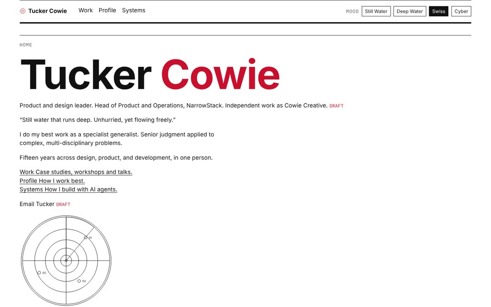

# New mood test

The brief asks that a new mood be one stylesheet and one registry line. This
is the record of testing that claim with a throwaway mood before the launch
moods were finished.

## What was done

In a separate working copy:

1. Wrote `src/moods/swiss.css`, 80 lines: a white ground, one grotesque, black
   rules and one red. A token block on `:root`, then rules that use only those
   tokens. It was written quickly and is crude on purpose.
2. Added one line to `src/moods/registry.mjs`.

Nothing else changed: no template, no content file, no build code, no check.

## What happened

- The build compiled the sheet, scoped it, and added a fourth button to the
  switcher on every page. `?mood=swiss` worked at once.
- `tools/lint-mood.mjs` found four raw lengths outside the token block and
  named each one. Moving them into tokens made it clean.
- All 34 mood delivery checks passed with four moods registered: precedence,
  first paint, scripting off, switching without a reload, carry-over.
- The page checks picked the new mood up from the registry and ran every key
  page in it at three widths with no change to the checks. They failed it
  where a crude sheet should fail: tables and the portrait ran off a 320px
  screen, and Home did not fit one view.

## What it shows

The claim holds. A mood is one stylesheet and one registry line, and the lint
and the browser checks hold a new mood to the contract without being told it
exists. A mood may use any face already declared in `src/build/fonts.mjs`; a
new face is one more line there and a row in `DEPENDENCIES.md`.

The test mood was discarded. Swiss as a real mood has its own reference
pack in `docs/product/design/later/swiss/`.
